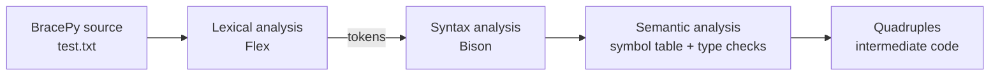

<div align="center">

# 🧩 BracePy Compiler

**A compiler for a statically typed language that mixes C-style syntax with Python-inspired keywords.**

Lexical analysis · Syntax analysis · Semantic analysis · Symbol table · Quadruple generation


</div>

---

## 📖 About

**BracePy** is a small programming language designed and implemented as an academic project in the Compilation course at **ESI (École Nationale Supérieure d'Informatique), Algiers**.

It takes the structure of C (braces, semicolons, static types) and borrows readable keywords from Python (`def`, `elif`, `foreach … in`, `and`, `or`, `not`, `import`). This repository contains the complete compiler front end, written with **Flex**, **Bison** and **C**.

Given a BracePy source file, the compiler:

1. splits it into tokens (**lexical analysis**),
2. checks that it follows the grammar (**syntax analysis**),
3. checks types and declarations while parsing (**semantic analysis**, with a **symbol table**),
4. produces **quadruples**, an intermediate code representation that a back end can turn into machine code.

## 🔄 Compilation pipeline



## ✨ The language at a glance

| Category | What BracePy supports |
|---|---|
| **Types** | `int`, `float`, `str`, `bool`, `const` declarations, arrays, user-defined structures (`type`) |
| **Operators** | `+ - * / % // **`, comparisons `< <= > >= == !=`, logical `and` `or` `not`, compound assignment `+= -= *= /= %=`, `++` `--` |
| **Control flow** | `if` / `elif` / `else`, `switch` / `case` / `default` / `break`, `for`, `while`, `foreach … in` |
| **Functions & modules** | `def` with typed parameters and return type, `return`, `import` |
| **I/O** | `input`, `print` keywords |

### Example

```c
int a = 5;
int b = 3;
int c = 5 + 3;                    // c should be 8

str r = "Hello, " + "world!";      // string concatenation

bool x = true or false;
bool z = not true;

while (true) {
    a--;
};
```

The compiler reports semantic errors while parsing, for example a **type mismatch** in an initialization or an **identifier declared twice**.

### Intermediate code

Every operation becomes a quadruple `(operator, operand 1, operand 2, result)`, with temporaries named `R<n>`. For example, `bool d = (5 > 7);` produces the following quadruples (illustrative format):

```
1: ( >  , 5 , 7 , R1 )
2: ( := , R1,   , d  )
```

## 🗂️ Project structure

| File | Role |
|---|---|
| `lexical.l` | Flex specification: token definitions and lexical errors |
| `syntaxic.y` | Bison grammar with semantic actions and quadruple generation |
| `symboleTable.c/.h` | Symbol table: declarations, lookup, values |
| `quadruplet.c/.h` | Quadruple list and its operations |
| `structure.c/.h` | Data structures for expressions, arrays and variables |
| `stockSauv.c/.h` | Storage helpers used during analysis |
| `global.h` | Shared definitions |
| `test.txt` | Sample BracePy program used as input |

## 🚀 Build & run

**Requirements:** `flex`, `bison`, `gcc`

```bash
# Ubuntu / Debian
sudo apt install flex bison gcc
```

```bash
flex -l lexical.l
bison -d syntaxic.y
gcc lex.yy.c syntaxic.tab.c quadruplet.c stockSauv.c structure.c symboleTable.c -lm -lfl -o test.exe

./test.exe
```

By default the compiler reads the source program from `test.txt`. Edit that file or change the `file` variable in `syntaxic.y` to compile your own program.

Hadjer Laissaoui**, ESI Algiers · [LinkedIn](https://www.linkedin.com/in/hadjer-laissaoui-13a420255/) · [Medium](https://medium.com/@hadjerlais77)

<!-- Add your teammates here if you built this project as a group. -->
